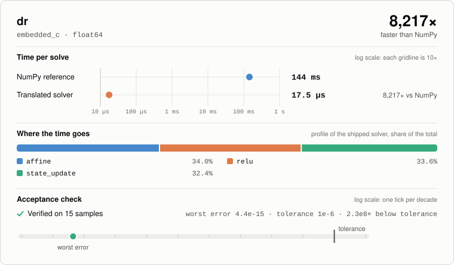

# Code generation guide

Once a first-order method has been verified with a
[`Verifier`](../api/verifier.md), FOMTools can generate a fast, low-level
implementation of it — in the spirit of
[OSQP codegen](https://osqp.org/docs/codegen/index.html) — together with a tiny
Python wrapper. The translation is performed by an LLM coding agent that writes
the target code and iterates against a Python reference oracle until the output
is numerically verified.

This page is the reference for that pipeline: how to record a method, when a run
rolls back up into a loop, how to declare an iteration-varying coefficient, and
what the emitted project contains. The
[user guide](index.md#code-generation) introduces the same pipeline in
brief, the [tutorials](../tutorials/codegen.md) work through five complete
examples, and [the API page](../api/codegen.md) documents each symbol.

## Check your setup

A run needs a C compiler, `make`, and an installed, signed-in agent CLI. The
OpenMP and CUDA targets need more. One command reports what this machine has:

```
fomtools-codegen --doctor
```

```
Build tools
  ✓ C compiler          Apple clang version 21.0.0 (clang-2100.3.34.2)  (/usr/bin/cc)
  ✓ make                GNU Make 3.81  (/usr/bin/make)
  ○ OpenMP              /usr/bin/cc does not build with -fopenmp (...); the OpenMP target then builds single-threaded. ...

Agents
  ✓ claude (default)    2.1.330 (Claude Code)  (~/.local/bin/claude)
  ○ cursor              `cursor-agent` not found. Install the Cursor CLI ...

Targets
  ✓ embedded C          ready
  ✓ large-scale OpenMP  ready (single-threaded build only)
  ○ large-scale CUDA    cannot run: no nvcc
```

`✓` is found, `○` is missing or unusable but optional (the line says what needs
it), `!` is found but its `--version` failed, and `✗` is missing and required.
The report also lists the Python extras, `nvcc`, the GPU and cuDSS, and every
agent backend, including your own from `agents.yaml`. The exit status is nonzero
only without a C compiler or `make`. It takes no other argument, except that
`--agent NAME` marks that backend as the default.

The compiler is the one the generated Makefiles use: `$CC` when it is set, else
`cc`. The check runs each program with `--version`, builds one small OpenMP
file in a temporary directory, and asks `nvidia-smi` for devices. It never calls
a model, so it cannot tell whether an agent is signed in. For `claude-sandboxed`
on Linux it also looks for `bubblewrap` and `socat`, without starting the
sandbox.

From Python or a notebook:

```python
from fomtools.codegen import doctor

report = doctor()
print(report)  # the same text
report.ok, report.targets, report.agents
```

## Defining the FOM

The Python snippets below reuse the imports and problem data in the first block.
Calls to `codegen`, `codegen_rolled`, and `generate_code` run a coding-agent CLI that
is installed and already logged in (`claude` by default), unless you pass an explicit
`driver=`. Recording the method requires no coding agent.

Write the algorithm as a loop, exactly as you would to verify it, and keep the
iterate sequence. An
[`iterate_trajectory`](../api/verifier.md#fomtools.Verifier.iterate_trajectory) is
the tidiest way to hold it (see [accumulating methods](#accumulating-methods)
for why), but any list works:

```python
import numpy as np
import fomtools as ft

n, m = 2, 4
rng = np.random.default_rng(0)
A = rng.normal(size=(m, n))
b = rng.normal(size=(m,))
t = 1.0 / np.max(np.real(np.linalg.eigvals(A.T @ A)))
At = np.eye(n) - t * A.T @ A
Bt = t * A.T
K = 200

vp = ft.Verifier(method="simulator", obbt_solver=None)
b_param = vp.parameter(m, lb=b - 1.0, ub=b + 1.0)

z = vp.iterate_trajectory(K + 1)
z[0] = vp.iterate(n, lb=2, ub=2)
for k in range(1, K + 1):
    z[k] = vp.soft_threshold(At @ z[k - 1] + Bt @ b_param, lambd=t)
```

Verify it however you normally would, then hand the same object to `codegen`:

```python
result = vp.codegen("out/ista", iterates=z, name="ista")
```

There is nothing to restructure: the program you generate from is the program you
verified. Each iteration carries its own coefficients, so the recording may do
whatever it likes with the iteration index — a decaying step size, momentum, a
step whose *type* changes with `k`, or a reference to an earlier iterate held
across the whole run, as in a Halpern anchor.

### Rolling back up

Generating the run literally would emit `K` blocks, which for a method that does
the same thing every iteration is wasteful. So before unrolling anything,
extraction pulls out iteration one on its own and asks whether repeating it
reproduces the recording. When it does, that compact IR is what gets emitted —
one block, whatever `K` was:

```python
result = vp.codegen("out/ista", iterates=z)
result.ir.unrolled     # False: the run rolled back up
len(result.ir.body)    # 1
```

Rolling changes the artifact and never the computation. The rolled solver keeps
the **recorded** horizon rather than any horizon you configure, and the check that
decides to roll is the proof it was safe: it replays the recorded tape and
compares it against the rolled loop, iteration by iteration, over several
parameter draws. Pass `roll=False` to emit the unrolled body regardless.

`result.ir.unrolled` tells you which you got.

### Generating from a single iteration instead

If you would rather supply one stationary iteration and choose the loop count
yourself, `codegen_rolled` does that:

```python
next_state = z[1]
result = vp.codegen_rolled(
    "out/ista", next_state,
    iterates=[z[k] for k in range(1, K + 1)],   # optional, but see below
    param_values={b_param: b},                  # any value in the parameter set
)
```

Here the iteration **must** be stationary, because extraction reads it once and
emits a loop that repeats it. A coefficient that changes with the iteration index
would be frozen at whatever value the recorded iteration happened to use, and the
generated solver would run a different algorithm than the one you verified.
Passing `iterates` and `param_values` has that checked rather than assumed; omit
them and you get a warning, because nothing else in the pipeline can catch the
mistake — the reference oracle is itself a rolled loop, so it agrees with a
wrongly rolled iteration by construction.

`codegen` needs no such argument: it generates the recording itself, and gates the
result against the tape using parameter values it draws from the declared box.

## Accumulating methods

Douglas–Rachford and ADMM carry their iterate through an expression rather than a
step output:

```python
dr = ft.Verifier(method="simulator", obbt_solver=None)
q_dr = dr.parameter(n, lb=-1, ub=1)
kkt = np.eye(n) + A.T @ A
z_dr = dr.iterate_trajectory(K + 1)
z_dr[0] = dr.iterate(n, lb=2, ub=2)
for k in range(1, K + 1):
    u = dr.implicit_linear(z_dr[k - 1] - q_dr, output_mat=kkt)
    ut = dr.relu(2 * u - z_dr[k - 1])
    z_dr[k] = z_dr[k - 1] + ut - u        # not a step output
```

Written that way, each iterate references every leaf the previous one did plus the
new step outputs, so the expression grows down the trajectory — leaf support runs
3, 5, 7, 9, … — and generating the run would need a number of matrix-vector
products that grows with the *square* of the iteration count.

`iterate_trajectory` handles this for you. Its default `collapse_expr="auto"`
notices the growth after two consecutive increases and keeps each subsequent
iterate as its own variable, which restores linear growth. A method that merely
*refers* to an earlier iterate — a Halpern anchor — holds its support flat instead,
so it is left alone. Nothing to configure either way.

Forcing `collapse_expr=True` opts out of that, and generating the resulting
recording raises `UnrolledBlowupError` with the measured counts rather than
emitting a solver nobody wants. (A stationary accumulating method is unaffected
either way: it rolls back up before size matters.)

## Generating the solver

```python
result = vp.codegen("out/ista", iterates=z, name="ista")
assert result.success
```

### Stopping early on a tolerance

A solver that exits once the iterate stops moving is a property of the *rolled*
form, so it comes from `codegen_rolled`:

```python
from fomtools.codegen import CodegenConfig, TerminationKind, TerminationSpec

config = CodegenConfig(
    termination=TerminationSpec(kind=TerminationKind.INF_NORM_CHANGE, max_iters=2000, tol=1e-6),
)

result = vp.codegen_rolled("out/ista", next_state=next_state, config=config, name="ista")
assert result.success
```

Generating from a recorded run runs that run, so there is no horizon to stop short
of and `codegen` rejects the infinity-norm criterion rather than quietly ignoring
it. Reach for `codegen_rolled` when you want that stopping rule, or `codegen` when
you want the algorithm you recorded. The verification objective (next section) is
the exception: `codegen` accepts it.

`TerminationSpec` also takes `check_termination` (named after OSQP's setting):
the residual is computed and tested only every `check_termination` iterations,
and `0` disables early exit entirely. The default is 1 — the generated check is
an infinity norm fused into the state copy, measured at 1–2.5% of iteration
time for direct-method FOMs, and checking less often overshoots the stopping
point by up to `check_termination - 1` full iterations. Raise it only for
matrix-free methods on large problems, where a single iteration is cheap
relative to a pass over the state.

### Stopping on the verification objective

`TerminationKind.INF_NORM_CHANGE` stops on `||x_k - x_{k-1}||_inf` over the whole
state, which is not the quantity you verified when your objective reads a scaled
or partial iterate, or is a KKT residual. `TerminationKind.OBJECTIVE` stops on the
objective itself, the one set with `maximize`, in the norm it was set
with (`ft.sum_squares` is the squared two-norm, as in verification):

```python
H = np.diag(np.linspace(1.0, 2.0, n))  # e.g. a diagonal scaling of the residual
vp.maximize(ft.norm(H @ (z[K] - z[K - 1]), np.inf))

config = CodegenConfig(
    termination=TerminationSpec(kind=TerminationKind.OBJECTIVE, max_iters=K, tol=1e-6),
)
result = vp.codegen("out/ista", iterates=z, config=config)
```

The solver tests `r^k <= tol` every `check_termination` iterations (default 25)
and always at the last one, and reports `r^k` in `solution.residual`. The test is
then exactly the certified quantity: if verification shows `r^K <= tol` over the
whole parameter set, the generated solver is guaranteed to stop by iteration `K`
with `FOM_SOLVED`. It also means experiments can time every solver at the same
tolerance without searching over iteration counts.

The objective is written at iteration `K` in terms of `w^K` and `w^{K-1}`, and is
mapped exactly onto what the loop holds at the end of an iteration: the new and
current state, the parameters, the step outputs of the iteration (when the
objective is written on the iteration the solver was extracted from), and ReLU
steps recorded after the loop for one-sided terms such as `max(Ax - u, 0)`. A row
holding a ReLU must hold only that term. An objective written after the loop, as
above, needs the recorded iterates to locate iteration `K`; `codegen` has them,
and `codegen_rolled` takes them through `iterates=`. Anything the loop does not
carry (an iterate older than `w^{K-1}`, an iterate accumulated as a non-leaf
expression, a parameter the iteration never reads) raises
`ObjectiveExtractionError` saying what to change: carry the older iterate in the
state, or record the iterates with `iterate_trajectory`.

The metric is generated as `fom_objective(...)` in its own source,
`src/fom_objective.c` (beside the kernels in `src/fom_ops.cu` on CUDA), which the
coding agent may never edit, even where it may rewrite the matrix-vector
products; the agent's loop only decides when to call it. `make verify` checks the stopping iteration, the
objective value and the status against the reference oracle, at the default
settings and at other runtime `check_termination` and `max_iter`. An unrolled run
(one that does not roll back up) evaluates the objective once, after its single
pass.

This requires a coding agent: an installed, logged-in agent CLI. Claude Code
(`claude`, the default), Codex (`codex`), Pi (`pi`), and Cursor (`cursor-agent`)
are bundled in `fomtools/codegen/agent/agents.yaml`, and any other headless agent
can be added there or in `~/.config/fomtools/agents.yaml`. No Python packages are
needed for it. Without a `driver=`, FOMTools uses `claude`, or the agent named in
`FOMTOOLS_CODEGEN_BACKEND`. Pass an explicit driver (for example a `StubAgentDriver`
wrapping a known-good source) for fully deterministic, offline runs. Set
`FOMTOOLS_CODEGEN_AGENT=0` to turn real agents off, as the test suite does.

Select the agent with `FOMTOOLS_CODEGEN_BACKEND` (or `--agent` on the command
line). The agents run with full access by default; see
[the restricted profiles](#what-the-agent-may-do-and-the-restricted-profiles).
Each agent uses its CLI's own default model and configuration, so it
follows the CLI's updates. To pick a model, set `CodegenConfig(agent_model=...)`
(`--model` on the command line), which takes precedence over
`FOMTOOLS_CODEGEN_MODEL`:

```python
config = CodegenConfig(agent_model="claude-opus-5-5")
```

The emitted directory (`out/ista`) contains:

```
include/   fom_solver.h, fom_workspace.h, fom_data.h   (ABI + dims + data decls)
src/       fom_solver.c (the agent's solver), fom_data.c (all numeric data)
test/      SPEC.md, spec.json, data.npz, verify_main.c, verify_data.h
python/    fom_solver.py   (ctypes wrapper)
Makefile   (make verify / make lib)
fomtools_manifest.json   (verification record, written when the run verified)
```

`fomtools_manifest.json` records the fomtools version, the target and dtype, the
numbers of the passing verify (samples, worst max-abs error, tolerance), the
timings when measured, and a SHA-256 of every source a library build compiles
(`src/`, the generated headers in `include/`, and `release/`). A new run on the
directory removes it first, so a run that fails or is interrupted leaves none.
An interrupted code optimization round also puts the best verified sources back.

### What the agent may do, and the restricted profiles

The agent runs in the output directory. All it needs is to read and edit files
there and to run the target's `make` targets (`verify`, `bench`, `profile`) and
the binaries they build. The default profiles do not enforce this. They turn the
CLI's own permission checks off, so the agent can run any command and write
anywhere you can:

| Profile | Flags that grant access |
|---|---|
| `claude` | `--permission-mode bypassPermissions`, with the file tools and an unrestricted `Bash` |
| `codex` | `--dangerously-bypass-approvals-and-sandbox` |
| `pi` | `--print --approve`, with pi's unrestricted `bash` tool |
| `cursor` | `--print --force` |

Two opt-in profiles confine the agent. Select them like any other agent, with
`--agent claude-sandboxed` or `FOMTOOLS_CODEGEN_BACKEND=codex-sandboxed`. The
defaults are unchanged.

- `claude-sandboxed` runs Claude Code with `--permission-mode acceptEdits` and
  `--permission-prompts none`. File edits inside the output directory are
  accepted. Anything else that would need approval is denied instead of asked.
  `--tools` limits the built-in tools to `Read`, `Write`, `Edit`, `Bash`, `Glob`
  and `Grep`. `Bash` runs only `make ...`, `./verify_bin`, `./bench_bin` and
  `./profile_bin`, plus the commands Claude Code permits on its own inside the
  output directory (`ls`, `cat`, `grep`, a redirect to a file there, and the
  like). A compiler or interpreter call outside `make` is refused, and so is
  `make` behind a variable assignment (`FOO=1 make bench`). Pass `make`
  variables as arguments instead (`make verify OMPFLAGS=-fopenmp`). Those
  commands run in Claude Code's Bash sandbox (Seatbelt on macOS, `bubblewrap`
  and `socat` on Linux), which lets them write only in the output directory and
  `$TMPDIR` and gives them no network. The sandbox is what confines an edited
  `Makefile` or the solver binary itself. The command list alone would not. The
  run fails at startup if the sandbox cannot start. The deadline hook and the
  isolation from your own settings are those of `claude`. A run leaves an empty
  `.claude/` directory in the output directory, which you can delete.
- `codex-sandboxed` runs `codex exec --sandbox workspace-write` in place of the
  bypass. Commands can write only in the output directory, `/tmp` and `$TMPDIR`,
  and have no network. `codex exec` never asks for approval, so a blocked command
  fails. Any command may run, not only `make`.

Neither profile keeps your files private. They limit writes and network access,
not reads:

- With `codex-sandboxed`, every command can read any file you can.
- With `claude-sandboxed`, the file tools and the shell commands Claude Code
  inspects (`cat`, `wc`, and the like) are refused outside the output directory.
  A `make` recipe or a compiled binary is not inspected. It can read any file you
  can, such as `~/.ssh` or a file of API keys.
- With both, commands inherit your environment variables, including any keys in
  them.

What a command prints goes back to the agent, and so to its model provider. The
sandbox blocks other network access from the commands, but not that channel. To
hide files from the commands of `claude-sandboxed`, copy its entry to
`~/.config/fomtools/agents.yaml` and add paths under `sandbox.filesystem.denyRead`
in its `--settings` (for example `"filesystem":{"denyRead":["~/.ssh"]}`, which
was checked to block the read inside `make`). Denying the whole home directory
stops `make` when the output directory is inside it. To
keep everything else out of reach, run FOMTools in a container or a virtual
machine.

Pi and Cursor have no restricted profile. Pi can switch whole tools off
(`--tools`), but it cannot limit what its `bash` tool runs or where it writes.
The Cursor CLI was not available to check. To confine either one, run FOMTools
inside a container or a virtual machine.

The checks that decide the result (`make verify` and the benchmarks that compare
two solvers) are run by FOMTools itself, outside the agent's sandbox, so the
reported timings do not depend on the profile. The timings the agent measures for
itself with `make bench` do run inside the sandbox. In one run on macOS they
were within 3% of the package's.

Both profiles were checked on macOS with Claude Code 2.1.330 and Codex CLI
0.167.0:

| Attempt | `claude-sandboxed` | `codex-sandboxed` |
|---|---|---|
| `make` builds and runs a binary in the output directory | allowed | allowed |
| Inside `make`: write to a sibling directory or the home directory | denied | denied |
| Inside `make`: write to `$TMPDIR` | allowed | allowed |
| Inside `make`: write to `/tmp` | denied | allowed |
| Inside `make`: network request | denied | denied |
| Inside `make`: read `~/.ssh` or another file in the home directory | allowed | allowed |
| Directly: `curl --version`, `cc --version`, `sh -c ...`, `FOO=1 make` | denied | not checked |
| Directly: a network request with `curl` | denied | denied |
| Directly: `touch` outside the directory | denied | no file created |
| Directly: read a file outside the directory (`Read`, `Grep`, `cat`, `wc`) | denied | allowed |
| Directly: `Write` outside the directory, or a redirect or `tee` to there | denied | not checked |

One run of the `ista` example on the embedded C target passed `make verify` with
each profile. With `claude-sandboxed`, one more run with a code optimization
round passed too, and the agent ran `make profile` and `make bench` inside the
sandbox. Not tested: the OpenMP target (it runs the same `make` targets, so it is
expected to work), code optimization with `codex-sandboxed`, Linux, and the CUDA
target. The CUDA target needs `nvcc` and access to the GPU device, which a
sandbox may block, so use the default profiles there until you have checked it on
your machine.

## Using the generated solver

From C, via the OSQP-style ABI:

```c
#include "fom_solver.h"

int main(void) {
    FomWorkspace work; FomSettings s;
    FomParams params = {0};             /* example parameter p0 = 0 */
    fom_set_default_settings(&s);
    fom_setup(&work, &s);
    fom_update_params(&work, &params);   /* set params.p0[...] */
    fom_solve(&work);                    /* work.solution.x holds the solution */
    fom_cleanup(&work);
    return 0;
}
```

Or from Python:

```python
import subprocess, sys
subprocess.run(["make", "lib"], cwd="out/ista", check=True)
sys.path.insert(0, "out/ista/python")
from fom_solver import Solver

solver = Solver()
out = solver.solve(p0=b)          # {"x", "iter", "residual", "status"}
solver.update_settings(tol=1e-8, check_termination=10, max_iter=500)  # runtime
```

`Solver()` and `fomtools.codegen.harness.build_lib` first check the sources
against `fomtools_manifest.json`. A directory without one (older output, or a run
that did not finish) loads with a warning. If a recorded source changed after
verification they raise an error naming the files; pass `allow_unverified=True`
to get a warning instead. A record that cannot be read is treated the same way.
The wrapper and a built library deployed without the sources load with a warning.

## Performance: timing, profiling, and the code optimization phase

Pass `code_optimization=True, profile=True` (the default for the `fomtools-codegen`
CLI with `--driver agent`) to (a) measure the speed of the generated solver
against the Python reference, and (b) enter the code optimization phase, an
iterative, profile-guided rewrite of the solver:

```python
result = vp.codegen(
    "out/ista", iterates=z, name="ista",
    code_optimization=True, profile=True,
)
print(result.timing.summary())
```

After the translation phase verifies, the orchestrator records a baseline (Python
reference time, the translated generated-C time, and a profiling breakdown). Then the agent
runs a loop: **profile → optimize the hottest region → `make verify` (correctness
is re-checked every round) → `make bench` → repeat** until gains level off. A
change that breaks verification is never kept, and if the whole phase leaves the
solver regressed, the verified translated solver is restored automatically. The
files the agent may rewrite, and how each is checked, are described
[below](#what-the-agent-may-rewrite-and-how-it-is-checked).

`result.timing` (a `TimingReport`) holds `python_us`, `c_initial_us`,
`c_final_us`, the speedup factors (`speedup_codegen`, `speedup_optimization`,
`speedup_total`), and the final `profile` breakdown, and `.summary()` formats
them. The two C times come from the head-to-head benchmark described
[below](#the-performance-gate); `c_initial_stats` and `c_final_stats` hold their
run-to-run spread, printed as `± MAD (fastest to slowest, runs)`, where MAD is
the median absolute deviation of the runs:

```
Timing summary (per solve):
  Python reference (before codegen):    1.33 ms
  Generated C (translated):             1.75 µs  ± 0.004 (1.749 to 1.790 µs, 5 runs)
  Generated C (optimized):              1.64 µs  ± 0.010 (1.630 to 1.700 µs, 5 runs)
  Speedup from codegen (Py -> C):       757.7x
  Speedup from code optimization:       1.07x
  Total speedup (Py -> optimized C):    809.9x
Profiling breakdown (hottest first):
  soft_threshold              20.2 µs   51.21%  (1000000 calls)
  state_update                19.3 µs   48.79%  (1000000 calls)
```

The attributes stay in microseconds. Printed times pick their unit (ns, µs, ms
or s) and show three significant digits; a spread is printed in the unit of its
median.
The optimized solver and the two speedups that involve it are printed only
when the code optimization phase kept a round.

The generated directory also exposes `make bench` and `make profile` directly.

### Watching the run

Pass `verbose=True` to follow the run as it happens: one line per phase, one per
optimization round with a bar that shrinks with the solve time, and a final summary
with the optimizations the agent kept. On a terminal a spinner shows the elapsed
time. Output of a real run on the Lasso example (ISTA, 200 iterations, embedded C):

```
✓ extract + scaffold           data, factorizations, matvecs  0 s
✓ translate → C (agent)        VERIFY OK  max err 0e+00  1.95 µs  95 s
✓ optimize · round 1 (agent)    1.43 µs →  1.29 µs  ███████████░  1.10x  VERIFY ✓  1814 s
✗ optimize · round 2 (agent)   1.18 µs vs 1.01 µs best, not faster, reverted  1584 s

  lasso
  translated C     1.43 µs  ██████████████████████████████
  optimized C      1.29 µs  ███████████████████████████  1.10x faster
  NumPy            1.50 ms
  VERIFY OK  worst error 4.4e-16 over 8 samples
  what the agent found:
  • Ping-pong state/new_state buffers, drop per-iter copy
  • Hoist bias_t0 computation outside the iteration loop
  • Inline t0_state matrix coefficients, unroll 4x4 product
  • Fuse fom_iterate into single inlined matvec+soft+add
  • Rewrite soft-threshold as v - clamp(v,-l,l) via fmin/fmax
  • ...
```

#### The performance gate

Each round is timed head to head against the best solver so far: both are built
once, then run five times each in alternating order.
One `make bench` warms up for 20 ms and then times full solves for 100 ms, so even
a microsecond solve is timed over many thousands of runs. The times printed for a
round can still differ from earlier lines by a few percent.

Run `i` of the rewrite and run `i` of the best solver are taken back to back, so
they form a pair, and the gate works on the five ratios rewrite/best. The *gain*
is one minus their median. The *noise* is twice their median absolute deviation
(MAD), a spread that one or two slow runs do not move. Then

| round | the rewrite is kept if | why |
|---|---|---|
| 1 | `gain >= -noise` | the translated solver is the baseline: a rewrite of the same speed is kept, a measurably slower one is not |
| 2 and later | `gain > noise` | each round must be a measured gain, so that rounds inside the noise cannot add up to a slower solver |

A rewrite that is not kept, or fails verification, is reverted, and the phase
ends. A kept round whose gain is below `agent_optimize_min_gain`, or inside the
noise (possible in round 1 only), also ends the phase. With no real difference,
five pairs put the median ratio outside the noise band on a given side in fewer
than 1 comparison in 10 (the old rule kept such a later round half the time); a
gain of three times the run-to-run noise of one timing is detected about 9 times
in 10. A line `not measurably faster` in the verbose output marks a rewrite whose
median time was lower, but by less than the noise. A round with fewer than four
pairs of successful runs is not kept: too few to estimate the noise.

`OPTIMIZATIONS.md` reports each side as `median ± MAD (fastest to slowest)`, next
to the round's gain and noise, so the decision can be read off the table.
The portable region profiler (`include/fom_profile.h`) is compiled in only for
`make profile` (`-DFOM_PROFILE`); its `FOM_PROF_BEGIN/END` macros are no-ops in
the shipped `make verify` / `make lib` builds, so profiling never affects the
production solver.

### Time budgets

Each agent phase runs under a budget, set per run on `CodegenConfig`:

| setting | default | bounds |
|---|---|---|
| `agent_timeout_s` | 600 s (10 min) | wall-clock time of the translation phase |
| `agent_optimize_timeout_s` | 7200 s (2 h) | wall-clock time of one code optimization round |
| `agent_optimize_rounds` | 5 | maximum number of code optimization rounds |
| `agent_optimize_min_gain` | 0.02 | a round gaining less than this (relative) ends the phase |
| `check_timeout_s` | 1800 s (30 min) | wall-clock time of each build, verify, benchmark, or profile run by the package |

The code optimization phase runs in rounds. Each round is a fresh agent run on
the fastest verified solver so far, told its current time and profile. After each
round the pipeline re-verifies the rewrite (including the kernel rules) and
benchmarks it head to head against that solver. A round that fails, is not
faster by more than the measurement noise, or gains less than
`agent_optimize_min_gain` ends the phase; a failing or not faster one is reverted
first (see [the performance gate](#the-performance-gate)). `OPTIMIZATIONS.md`
lists the rounds.

Each round's summary also lists, under `Blocked by rules:`, the optimizations
the agent considered but did not make because a rule forbade them, with the rule
and an expected gain. They appear as a table in `OPTIMIZATIONS.md` and as
`rule_friction` on the result. Collected across problems, they show which rules
cost speed, and so which ones are worth replacing by an exact check that admits
the optimization.
`fomtools.codegen.generate.run_code_optimization` runs the phase on any directory
that holds a verified translated solver, for example a copy, when you want to
keep the translated solver too.

Translation is a bounded task and rarely needs more than a few minutes. The code
optimization phase is open-ended, and on a GPU every round (an `nvcc` build,
`make verify`, `make bench`) is slow, so it gets two hours. Raise the budgets for
larger problems:

```python
config = CodegenConfig(agent_optimize_timeout_s=4 * 3600)
result = generate_code(..., config=config, code_optimization=True)
```

or, on the command line, `--translate-timeout`, `--optimize-timeout` (seconds),
`--optimize-rounds` and `--optimize-min-gain`. The
budgets apply to whichever agent driver runs, a driver you build yourself included: one built without a config takes the run's.
A minute before a budget runs out, the agent is told to stop through the
`FOMTOOLS_DEADLINE` environment variable (Unix time). The bundled Claude Code spec
reads it in a hook that then refuses further tool calls and asks for the summary;
an agent you add can do the same. When the budget runs out the agent is stopped, whatever it wrote is re-verified and
benchmarked as usual, and the report says so (in that case the agent may not have
written its own summary). For reference, a CUDA CG solve stopped at 30 minutes
had already gone from 2.05 s to 0.114 s per solve and was still improving.

The checks the package runs itself (`make verify`, the benchmark, the profile)
are outside the agent budgets and have their own limit, `check_timeout_s`
(`--check-timeout`). They build and run code the agent wrote, which may loop
forever. A check still running at the limit is stopped together with everything
it started, and counts as failed: the agent is told that the verify was
terminated and can fix the solver, and a benchmark or profile is reported as
missing. A healthy check takes seconds, or a few minutes on a GPU, so the default
only stops one that hangs.

### The report card

Every run that ends with a verified solver writes `report.svg` into the output
directory: one picture of what the run measured. This is the card of the
built-in Douglas-Rachford example (`fomtools-codegen --example dr`), translated
with the code optimization phase off:



From top to bottom, each part drawn only when the run has its data:

- **Time per solve** of the NumPy reference, the translated solver and, when an
  optimization was kept, the optimized solver. The axis is logarithmic, since
  the generated code is often hundreds of times faster than NumPy: each gridline
  is a factor of 10, and equal distances are equal ratios. A logarithmic axis
  has no zero, so each time is a dot at its position and not a bar. The numbers
  are printed next to the dots, with the range from the fastest to the slowest
  run when the head-to-head benchmark recorded it. With the code optimization
  phase off, or no round kept, there is no optimized solver on the card.
- **Optimization rounds**, one row per round on a linear axis that does not
  start at zero: a filled disc for a kept round, a ring for a reverted one, a
  cross for a round that failed verification, each with its time and the reason
  (`not faster`, `inside noise`, `failed verification`). The percentage of a
  kept round is the gain the keep rule measured (one minus the median of the
  paired time ratios, as in the table of `OPTIMIZATIONS.md`); it can differ a
  little from the ratio of the two printed medians. The line follows the best
  solver so far.
- **Where the time goes**: the profile of the shipped solver as shares of the
  total, the five largest regions by name.
- **Acceptance check**: the number of verify samples and the worst error against
  the tolerance, on a logarithmic axis with one tick per decade. The check
  passes when the error is at or below the tolerance, so `2.3e8× below
  tolerance` means the error is that many times smaller than what is allowed.

The card is a standalone SVG with no scripts or external fonts. It carries its
own background and follows the light or dark preference of the viewer, so it can
go into a README or a paper repository as it is. `OPTIMIZATIONS.md` shows it at
the top. In a Jupyter or marimo notebook, a `CodegenResult` displays as the card
with a one-line summary (`result.summary()`); a failed run displays as a
failure message. A new run on the same directory first removes the card and
`OPTIMIZATIONS.md` of the earlier run. To draw the card yourself, for example in
a fixed theme:

```python
from fomtools.codegen.report_svg import result_report_svg

svg = result_report_svg(result, theme="light")  # "auto" (default), "light" or "dark"
```

### What changed, and a marker-free production build

When the code optimization phase runs, two extra artifacts are written:

- `OPTIMIZATIONS.md` — a durable record of the run: the report card, the timing summary, the
  agent's own notes, a **unified diff of every rewritten source** from the
  translated version to the optimized one, so you can see exactly what was
  changed, and a **kernel-check table** (see below). Also available
  programmatically as `result.optimization_diff` and `result.kernel_checks`.
- `release/fom_solver.c` (with `release/fom_linsolve.c` and `release/fom_ops.c`)
  — a **production copy with the profiling markers and the `fom_profile.h`
  include stripped**. The markers are already no-ops outside `make profile`, so
  this is behaviour- and performance-identical; it is just a clean,
  dependency-free source for embedding. Build it with `make release` (which links
  the shared library from `release/`), or drop it in for the `src/` files.

### What the agent may rewrite, and how it is checked

The translation phase writes only `src/fom_solver.c`. The code optimization
phase may also rewrite the two linear parts of the solver, where most of the time
goes. The package restores every other file before each check, so the numeric
data cannot change:

| file | in the code optimization phase | checked by `make verify` |
|---|---|---|
| `src/fom_solver.c` (the iteration) | rewritten by the agent | end to end, against the Python reference on sampled parameters |
| `src/fom_linsolve.c` (linear solves) | rewritten by the agent | each `fom_lin_solve_<name>` against the reference solve of its factorization, on random right-hand sides |
| `src/fom_ops.c` (matrix-vector products) | rewritten by the agent | each `fom_apply_<name>` exactly against its matrix, each `fom_fused_<block>` exactly against its members (below); each `fom_step_<block>`, `__rest` routine and `fom_iterate` exactly against its members and a reference activation |
| `src/fom_data.c`, `src/fom_objective.c`, `include/`, `test/`, `Makefile` | package only | — |

The end-to-end check solves on `num_verify_samples` (default 8) parameter vectors
drawn uniformly from the parameter box, then on up to 8 deterministic edge cases,
each compared with the Python reference at `tol_verify`:

- the all-lower-bound vertex, the all-upper-bound vertex, and the box midpoint;
- zero, when it lies inside the box (where soft-thresholding and ReLU switch);
- a mixed vertex, with each coordinate at its lower or upper bound, and the
  opposite vertex;
- two points on a face: an interior draw with a quarter of the coordinates pinned
  to a bound.

Uniform draws almost never reach the points where a projection saturates or a
comparison decides, so a wrong branch, `<` in place of `<=`, or a wrong bound can
pass them; the edge cases are where it shows. An infinite bound stands in as -1
or +1, as in the random draws, or as one unit past the finite bound on the other
side when that bound lies beyond the stand-in. Repeated vectors are dropped (a
parameter with `lb == ub` gives the same vertex twice), and the count does not
grow with the parameter dimension. The reported "worst max-abs error over N
samples" and the manifest count them, so a default run reports up to 16 samples.
The recorded outputs on this page that show 8 predate the edge cases.
`CodegenConfig(verify_edge_samples=False)` restores the random draws alone.

A vertex of the box can be an instance with no solution. With CVXPYgen, for
example, the box holds the propagated bounds of `q`, `b` and `u`, and its corners
need not be feasible. The check still applies there: the reference runs the same
iteration with the same stopping rule, and the two results are compared whether
or not the method converged.

A matrix-vector routine is a linear map, so it can be checked for **every**
input, not just sampled ones. `make verify` runs each `fom_apply_<name>` next to a
package-written reference (`test/ops_ref.c`) that reads the same `fom_data.c`
arrays, starting both from the same nonzero `out` (so the routine must still
accumulate, `out += M @ x`). The tolerance scales with `M @ x`, not with that
starting value, so each entry is held to `tol_kernel` relative to itself. A rewrite
may only reorder arithmetic, so `tol_kernel` (1e-10 in double precision) is far
tighter than the end-to-end `tol_verify`, and a slightly perturbed coefficient fails
here even where the sampled solves would absorb it:

- on **every unit vector** when the matrix is small enough
  (`cols × (nnz + rows) ≤ 1e8`): this recovers the routine's matrix column by
  column, and a wrong coefficient is reported by its entry;
- on **two random vectors** always, which also catches a routine that branches
  on its input; above the budget these are the whole check.

The check stores no matrix-sized data: the expected values are computed in C from
`fom_data.c`, and the only stored data are the random probe vectors.

**Fused products.** Some speedups come from relations *between* matrices, which
no single `fom_apply_<name>` can see. In an accelerated method the slope of the
momentum term is often a signed rearrangement of the base block
(`D = [-A1, A1]` for `A = [0, A1]`), so `A x + gamma D x` is one smaller product,
`A1 (x1 + gamma (x1 - x0))`. So `fom_ops.c` also holds one
`fom_fused_<block>(sources..., schedule values..., out)` per output block with two
or more products by the state or a temporary. It adds them all,
`out += sum_k s_k * (M_k @ src_k)`. Parameter terms stay out, so the solver can
still compute them once per solve. A fused routine may read the data of its
members, and only theirs. `make verify` checks it against the sum of its members'
references:

- on every unit vector of each source (the other sources zero), first with every
  schedule value at 0 and then with each alone at 1. At each setting the routine
  is linear in the probed source, so this recovers every member exactly, entry by
  entry;
- on two random choices of all sources and schedule values, which catches a
  routine that is right only at 0 and 1, or not linear in its inputs.

`fom_ops.c` may not read the schedule tables or accessors (`fom_sched_*`,
`FOM_SCHED_*`). A routine gets its schedule values as arguments, so it cannot
special-case the values the solver will pass it; with the no-new-literals rule,
it has nothing to compare them against.

**Selections.** A matrix with at most one nonzero per row, every nonzero exactly
1, is a copy: an identity, a shift, or a gather. `SPEC.md` lists these, and
`fom_data.h` carries each index map as `FOM_SEL_<name>_SRC` (-1 for an empty
row). The solver may apply them itself (or write a result straight to its
destination) instead of calling `fom_apply_<name>`. Such a copy is checked end to
end only; a wrong index moves whole entries of the state, which the sampled
comparison sees. CUDA has neither fused routines nor selection maps: its products
run on the device from `fom_ops.cu`'s own arrays.

**Step routines.** A fused routine still leaves the activation, the constant
and the parameter terms to the solver, and it accumulates, so the solver zeroes,
copies and makes a second pass over every block. `fom_ops.c` therefore also holds
one `fom_step_<block>(sources..., schedule values..., bias, act, out)` per output
block (each body step without a linear solve, and the state update `su`). It
computes the whole block, `out = act(bias + sum_k s_k * (M_k @ src_k))`, and
**overwrites** `out`. `bias` is what the caller adds (the constant and the
parameter terms, which it can still hoist), and `act` points at the activation's
parameters: a `FomAct_<block>` with the soft-threshold `lambd`, or the `lo` (and
`hi`) bound vectors, whose package values are `FOM_ACT_<block>`. A step routine
must apply the parameters it is passed, so `make verify` can choose them:

- with the activation switched off (`lambd = 0`, bounds at ±1e300), on every
  unit vector of each source at every schedule setting and with a random bias.
  The routine is then linear, so this recovers every member and the bias
  pass-through exactly. `out` starts from garbage, so a routine that accumulates
  fails;
- on random sources, schedule values and biases, with the activation off, at
  the package parameters, and at random parameters drawn around the
  pre-activation values, which make it active on about half the rows. A routine
  that hardcodes a bound or threshold, or is wrong only where the activation is
  active, fails here, even one that recognizes the switched-off probes by their
  huge bounds.

`fom_ops.c` may not read `FOM_ACT_*`, the constant vectors, or the activation
bounds: they come in only through `bias` and `act`.

**The whole iteration.** `fom_iterate(state, schedule values..., bias_<block>...,
act_<block>..., t_<name>..., new_state)` chains the step routines of one
iteration (when no body step has a linear solve): it writes every temporary,
which the solver and `fom_objective` still need, and the new state. A rewrite can
keep values in registers from block to block and share intermediates between
them. It may read the data of every matrix of the iteration. `make verify`
compares every temporary and the new state with the chained reference steps: on
every unit vector of the state, with the activations off and zero biases, at
every schedule value alone at 1, all at 0, and one random setting (which catches
products of schedule values across blocks); then on random states, biases and
activation parameters as for a step routine.

**Selection rows.** A block whose rows are partly plain copies (exactly one
unscaled product with exactly one entry equal to 1 in the row, the others none)
lists those rows in `fom_data.h` as `FOM_SELROWS_<block>_ROW/SRC/COL`, described
in `SPEC.md`. Its `fom_fused_<block>__rest` and `fom_step_<block>__rest` compute
every other row. `make verify` holds them to the full reference on their rows
and checks that they leave every selection row bit for bit untouched. The solver
may then write the selection rows itself, a step block's as
`out[row] = act(bias[row] + src[col])`. Like whole selections, those copies are
checked end to end only.

Only code inside `fom_apply_<name>` goes through this check, so these rules keep
every coefficient there. A rewrite that breaks one is discarded:

- the solver may not read the `FOM_MAT_<name>` data of a matrix it multiplies
  by; it calls `fom_apply_<name>`. This rule already holds at translation
  (`make verify` applies it there too), so the code optimization phase starts
  from a solver that multiplies only through the checked routines. In
  `fom_ops.c`, a routine is `fom_apply_<name>` with every helper it calls (on
  CUDA, its `__global__` kernel); it may read only its own matrix's data, no
  other code (a macro, static data, an unreached function) may read matrix data,
  and every function but the `fom_apply_<name>` and `fom_fused_<block>` entry
  points must be `static`. A fused routine may read its members' data, and
  nothing in `fom_ops.c` may read the schedule;
- the solver and `fom_ops.c` may not add floating-point constants other than
  `0`, `0.5`, `1` and `2`: decimal or hexadecimal float literals, or integer
  literals cast to a floating type (coefficients come from `fom_data.c`). The
  exception is a `fom_apply_<name>`, `fom_fused_<block>`, step, `__rest` or
  iterate routine that `make verify`
  probes on every unit vector: those probes recover its matrix exactly, so it may
  hold its coefficients as literals (an unrolled product over the fixed sparsity,
  with the values inlined). A routine over the probe budget, checked on random
  vectors only, and the solver keep the rule;
- `fom_setup` and `fom_update_params`, and any function of the solver they
  reach, may not add uses of `fom_apply_*`, `fom_fused_*`, `fom_step_*` or
  `fom_iterate`, which is how a matrix would be
  rebuilt by probing it. This also rules out hoisting a product that depends
  only on the parameters out of the iteration and into `fom_update_params`: a
  syntactic rule cannot tell a parameter vector from a unit vector, and the
  guarantee is worth more than that speedup;
- every function the rules inspect must be a single plain C definition they can
  find; one they cannot find, or one defined twice (in `#if` branches, say), is
  a violation, not a skipped rule.

Literals and setup calls the translated file already had are exempt; in
`fom_ops.c`, per routine (and outside the routines, only against what the
translated file had outside them). The literal rule is syntactic: an integer coefficient
(`3 * x[j]`) or one computed from allowed constants gets past it, and the
numerical checks (exact for `fom_apply_<name>`, sampled for the solver) are what
catch those. `make verify` reports these rules while the agent works; the
pipeline applies them again when it collects the rewrite, and that check
decides.

`OPTIMIZATIONS.md` records the outcome for the shipped `fom_ops.c`:

```
| matrix | shape | nnz | rewritten | check | probes | max error |
|---|---|---|---|---|---|---|
| `t0_state` | 140x228 | 228 | no | basis | 230 | 0.000e+00 |
| `su_state` | 228x228 | 228 | yes | basis | 230 | 0.000e+00 |
```

A routine counts as rewritten when its body, a helper it reaches, or the file
scope (macros, static data) changed. The table is followed by any rule
violations found in the collected rewrite. `result.kernel_checks` holds the same
rows.

The large-scale CUDA target follows the same policy where `make verify` runs on
a GPU (detected with `nvidia-smi`, or forced with `FOMTOOLS_CUDA_RUN=1`):
`fom_ops.cu` and `fom_linsolve.cu` are editable, and the direct checks stage
each probe through device buffers and compare the result with the same host
reference. The device copies of the matrices live in the package-owned
`include/fom_ops_data.cuh`, and the objective in `src/fom_objective.cu`, so a
rewrite cannot change either. Without a GPU, verify only compiles, so only
`fom_solver.cu` is editable there; its rules still hold from translation on,
and `make compile` applies them.

## Linear solves: factorized, never inverted

Affine operators (e.g. the KKT solve inside ADMM/OSQP) are **never** turned into
a matrix inverse. At codegen time each system `M w = rhs` is factorized once —
**sparse LDLᵀ** for symmetric systems (the ADMM/OSQP KKT is symmetric
quasidefinite), **LU** otherwise — and the generated solver applies
**division-free** triangular solves (the factor diagonals are stored as
reciprocals). The factors live in `src/fom_linsolve.c` and are called as
`fom_lin_solve_<name>(rhs, out)`; the iteration code assembles the right-hand
side and calls them. `CodegenConfig(solve_method=...)` can force `LDLT`/`LU`;
`CG` (an indirect method for large/GPU problems) is reserved for a future
backend. The choice can depend on problem type and the CPU/GPU target — but a
matrix inverse is never formed or stored. The LDLᵀ factorization (by QDLDL)
uses a fill-reducing approximate-minimum-degree ordering so the factor stays
sparse (on the MPC KKT, 552 vs 19600 dense entries).

Likewise, every `matrix @ vector` product in the iteration is emitted as a
**sparse CSR** operation (`fom_apply_<name>` in `fom_ops.c`, over CSR arrays in
`fom_data.c`) when the matrix is
structured — the OSQP/MPC selection, dynamics, and state-update blocks are highly
sparse — and dense only when the matrix genuinely is. Together these make the
*initial* generated solver fast natively (no reliance on the code optimization phase
to recover structure): on the MPC example the un-optimized C solver already runs
~29× faster than the NumPy reference.

## Iteration-varying coefficients

Accelerated methods use a coefficient that changes every iteration: FISTA's
momentum `γ_k = (β_{k-1} - 1)/β_k`, Nesterov's `(k-1)/(k+2)`, a Halpern anchor
weight. Verification handles these for free — the tape is unrolled, so each
iteration just gets its own number.

Generating the recorded run keeps that property, so **nothing special is needed**.
Write the coefficient in Python, where the rest of your algorithm already lives:

```python
vp = ft.Verifier(method="simulator", obbt_solver=None)
b_param = vp.parameter(m, lb=b - 1.0, ub=b + 1.0)
y0 = vp.iterate(n, lb=2, ub=2)

y_prev, y_curr, beta = y0, y0, 1.0
iterates = []
for _ in range(K):
    beta_next = (1.0 + np.sqrt(1.0 + 4.0 * beta * beta)) / 2.0
    gamma = (beta - 1.0) / beta_next          # ordinary Python, evaluated while recording
    extrap = y_curr + gamma * (y_curr - y_prev)
    y_next = vp.soft_threshold(At @ extrap + Bt @ b_param, lambd=t)
    y_prev, y_curr, beta = y_curr, y_next, beta_next
    iterates.append(y_next)

vp.codegen("out/fista", iterates=iterates, name="fista")
```

Because the momentum genuinely varies, this run will not roll back up: each
iteration keeps its own coefficient blocks. The cost is one emitted block per
iteration, which is fine at a horizon of tens and impractical at a horizon of
hundreds.

A **schedule** buys back the compact loop. You declare which scalars vary,
FOMTools tabulates them at generation time, and the emitted loop reads the table
at its counter — one block total whatever the horizon, still division-free and
with no `libm` call. Two things differ: you supply the recording as a *function*
of the schedule scalars rather than a finished tape, and the state carries both
iterates the method needs:

```python
import numpy as np
from fomtools.codegen import CodegenConfig, Recording, TerminationSpec, generate_code
import fomtools as ft

def momentum(k):
    """FISTA's γ in the 0-based index of the emitted loop.

    Note the `k + 1`: γ_0 is the coefficient the *first* iteration applies, and it
    is 0. Stopping one step short is the easy mistake, and it silently shifts the
    whole schedule.
    """
    beta = 1.0
    for _ in range(k + 1):
        beta_next = (1.0 + np.sqrt(1.0 + 4.0 * beta * beta)) / 2.0
        gamma, beta = (beta - 1.0) / beta_next, beta_next
    return gamma

def build(gamma):
    vp = ft.Verifier(method="simulator", obbt_solver=None)
    b_param = vp.parameter(m, lb=b - 1.0, ub=b + 1.0)
    y_prev = vp.iterate(n, lb=2, ub=2)
    y_curr = vp.iterate(n, lb=2, ub=2)
    extrap = y_curr + gamma * (y_curr - y_prev)
    y_next = vp.soft_threshold(At @ extrap + Bt @ b_param, lambd=t)
    # the state shifts: (y_prev, y_curr) <- (y_curr, y_next)
    return Recording(vp, next_state=[y_curr, y_next], state=[y_prev, y_curr])

generate_code(
    build, None, "out/fista",
    schedules={"gamma": momentum},
    config=CodegenConfig(termination=TerminationSpec(max_iters=200)),
)
```

A schedule is a callable of the **0-based** loop index, a sequence, or a
`Schedule`. Textbook formulas are written in 1-based `k`, so shifting them is your
job: what a coefficient *is* belongs to the method, not to the code generator, and
nothing in the package knows any particular one. `as_schedule` calls a callable
with increasing indices, so a coefficient defined by a recurrence may cache it.

### Why a build function

A schedule scalar enters the recorded expression linearly, so every extracted
coefficient block is *affine* in it: `M(γ) = M₀ + γ M₁`. FOMTools evaluates
`build` at a few values of `γ`, recovers `M₀` and `M₁` by finite differences, and
holds one probe back to check the fit. The generated code then computes
`M₀ @ state + γ_k * (M₁ @ state)`, one extra matrix-vector product per varying
term.

That validation is what makes this safe rather than merely convenient. If a
coefficient does *not* depend affinely on the scalar — a product of two
schedules, or a scalar used inside a nonlinearity — the held-out probe fails and
you get a `ScheduleFitError` instead of a wrong solver.

### Declaring the state

Written over a single iterate, the dependency cone of iteration `k` reaches back
through every earlier step, so extraction returns the unrolled prefix rather than
a repeatable body. On the `codegen` path that is the intended answer. On the
scheduled and `codegen_rolled` paths it is not what you asked for, and a longer
body is still a valid body, so declaring `state=[y_prev, y_curr]` closes the cone
after one step. Worth remembering for any method that looks back more than one
iterate.

### What is not supported

The varying quantity has to be a linear-operator coefficient. These each raise a
clear error rather than lowering something wrong:

- a **factorized system matrix** that varies (an ADMM `ρ` that changes with `k`),
  since the factorization is computed once at generation time;
- a varying **activation scalar** — a soft-threshold level or a saturated-linear
  bound that changes with `k`;
- a varying **constant offset**;
- a scalar the build function ignores, which is nearly always a typo in its
  keyword name.

The table is sized to `max_iters`. Raising `settings.max_iter` past that at
runtime holds the last value rather than reading off the end; the generated
accessor `fom_sched_<name>(it)` clamps, and the static checker rejects any solver
body that indexes `FOM_SCHED_*` directly.

## Targets

`CodegenConfig` selects what to emit:

- **Embedded** (`version="embedded"`, `backend="c"`): statically sized, no
  dynamic allocation, division-free (matrix inverses are folded into the
  coefficients offline). The default.
- **Large-scale** (`version="large_scale"`): multithreaded CPU (`backend="openmp"`)
  or GPU (`backend="cuda"`). These are generated and compile-checked; runtime
  verification of the CUDA backend requires a GPU.

## CLI

```
fomtools-codegen --example ista      --out out/ista  --driver agent
fomtools-codegen --example dr        --out out/dr    --scaffold-only
fomtools-codegen --example mpc       --out out/mpc   --driver agent   # OSQP MPC, larger
fomtools-codegen --example fista     --out out/fista --scaffold-only  # a recorded run
fomtools-codegen --example scheduled --out out/sched --scaffold-only  # a declared coefficient
fomtools-codegen --module my_fom.py  --out out/mine  --tol 1e-6 --objective  # stop on the objective
```

The built-in `mpc` example is a model-predictive-control QP solved with **OSQP's
ADMM** — a constant KKT solve (the inverse is folded into the coefficients at
codegen time) followed by a box projection (saturated-linear) and the ADMM
recombinations. It is the largest built-in example (state dimension in the
hundreds), so it is a good showcase for the Python-vs-C and the optimization-loop
speedups.

`fista` and `scheduled` are the same accelerated lasso reached the two ways.
`fista` records it as an ordinary loop, so scaffolding it shows an unrolled
`SPEC.md`: one block per recorded iteration, `FOM_UNROLLED 1`, and no table.
`scheduled` declares the momentum instead, so it shows a single block, the
`FOM_SCHED_gamma` table in `fom_data.c`, and the clamping accessor. Scaffolding
both side by side is the quickest way to see what declaring a coefficient buys.

`--scaffold-only` emits everything except the solver body (useful to inspect the
spec and data before invoking the agent). `--no-roll` keeps a recorded run
unrolled even when it could be rolled back up. `--translate-timeout`,
`--optimize-timeout`, `--check-timeout` (seconds), `--optimize-rounds` and
`--optimize-min-gain` set the budgets for this run ([above](#time-budgets)),
and `--agent` and `--model` select the agent and its model. `--tol` alone stops on the
infinity-norm change; with `--objective` it stops on the verification objective
the module set on its recording, and `--check-termination N` sets the interval.

A custom FOM can be supplied with `--module mymodule.py`, where the module defines
`build_fom()` returning a dict. Which key you provide selects the path:

| keys | generates |
|---|---|
| `verifier`, `iterates` | the whole recorded run, rolled back up when that is verified to be equivalent |
| `verifier`, `next_state` | a rolled solver from one stationary iteration |
| `build`, `schedules` | a rolled solver with tabulated iteration-varying coefficients |

`name`, `state` and `params` are optional in all three.
